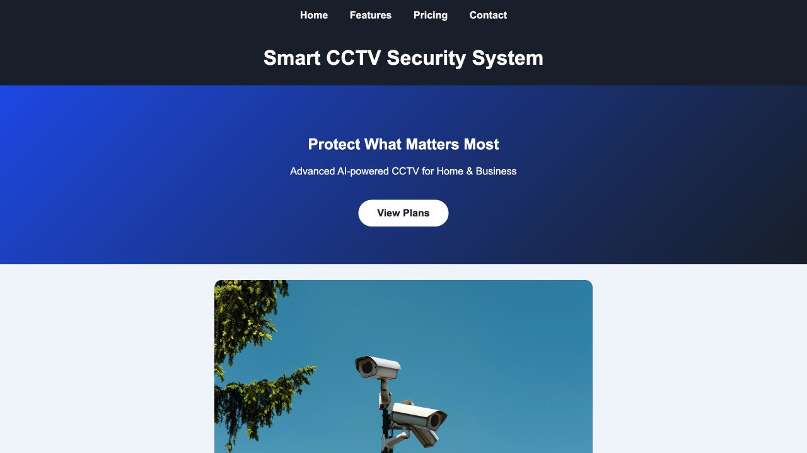

# Smart CCTV Website

**An HTML and CSS landing page for a smart surveillance concept, created for an academic assignment.**



*Actual page rendered locally from this repository's `index.html` and `cctv.jpg`, captured on 24 October 2026.*

## Overview

The page presents a fictional CCTV product through a hero section, camera image, feature cards, pricing comparison, ethical-use section and reference links.

**Built with:** HTML · embedded CSS · a local image asset. No build step or framework is required.

## Run locally

```bash
git clone https://github.com/smriazul2002-ux/smart-cctv-website.git
cd smart-cctv-website
python3 -m http.server 8000
```

Open `http://localhost:8000` in your browser. Alternatively, open `index.html` directly. Keep `cctv.jpg` beside it so the image resolves correctly.

## Repository structure

```text
index.html           Page structure and embedded styles
cctv.jpg             Camera image used by the page
website-preview.png  Screenshot of the rendered page
README.md            Project overview and setup
```

## Scope

This repository demonstrates front-end presentation. Product features, pricing and contact information shown in the page are assignment content. Camera integration, AI detection, subscriptions, cloud storage and a working contact service are not implemented here.

## Possible next improvements

- Check mobile layouts and keyboard navigation at different screen sizes.
- Separate styles into a dedicated CSS file as the page grows.
- Replace assignment placeholders before using the page for a real service.

## Verification

The page was served locally and its hero, navigation and camera image were visually checked on 24 October 2026. No application source was changed for this documentation update.
